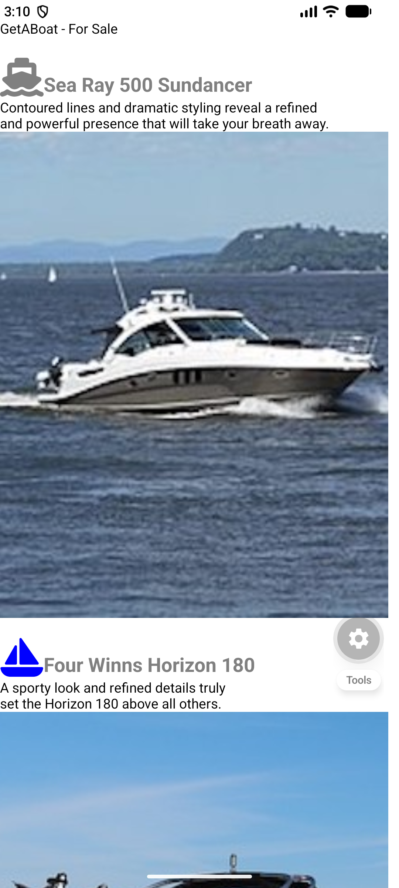
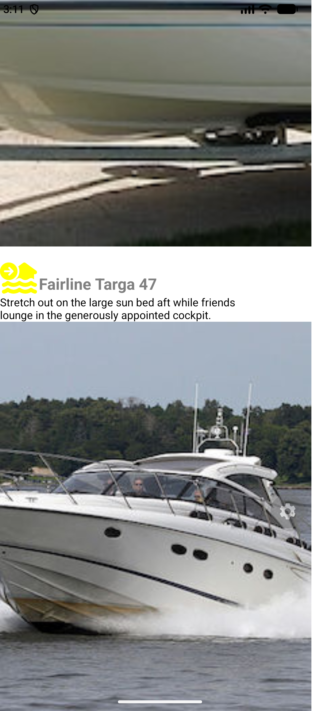
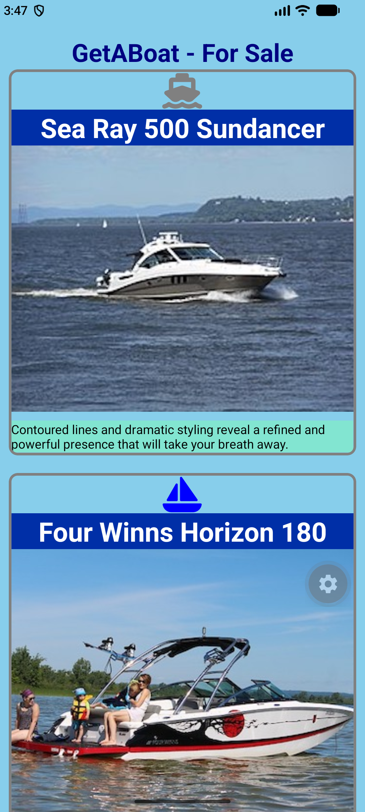
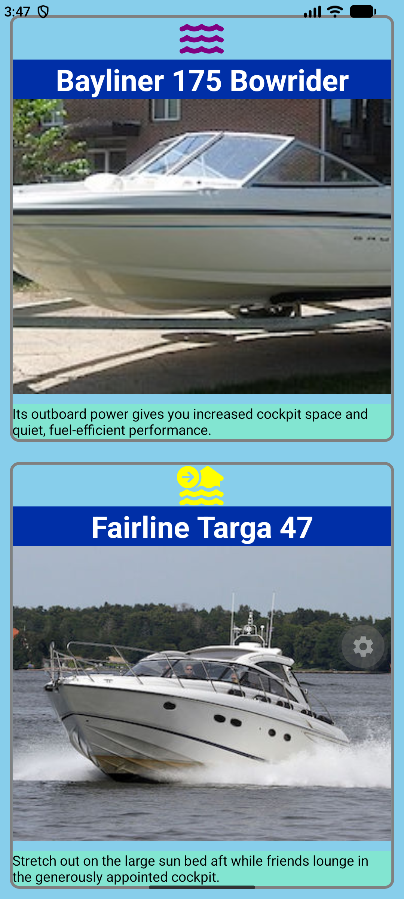

# App Name
L08

A brief description of the mobile application and its purpose. 
add styling to the app

# ScreenShots of App BEFORE applying Stylesheet changes
Screenshots:  

# ScreenShots of App AFTER applying Stylesheet changes

Screenshots:  

# Link to Demo Video with audible narration explaining styling changes with code reference

Demo Video Link:  

